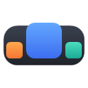
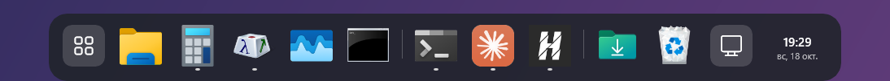
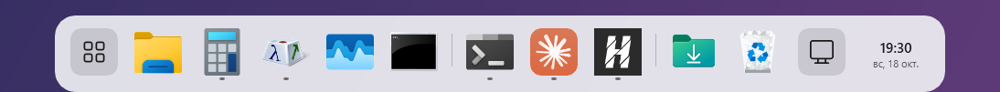
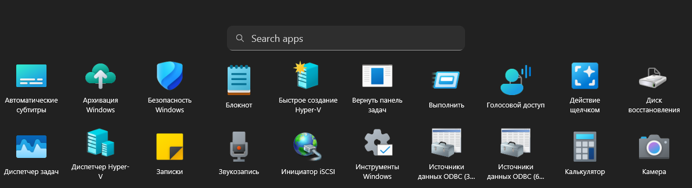
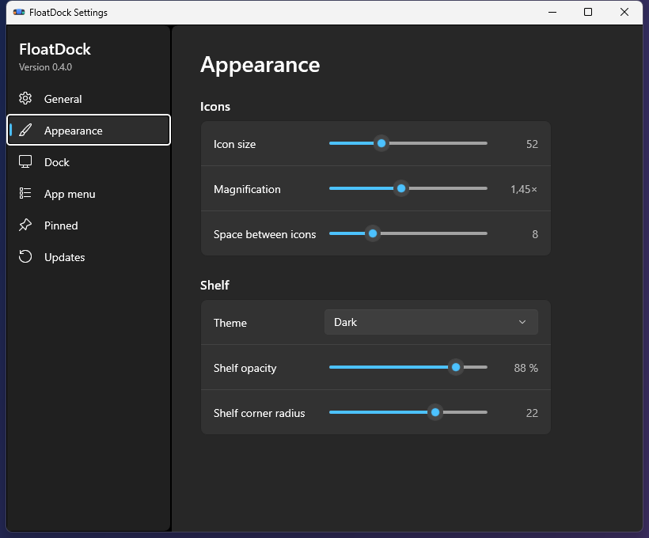
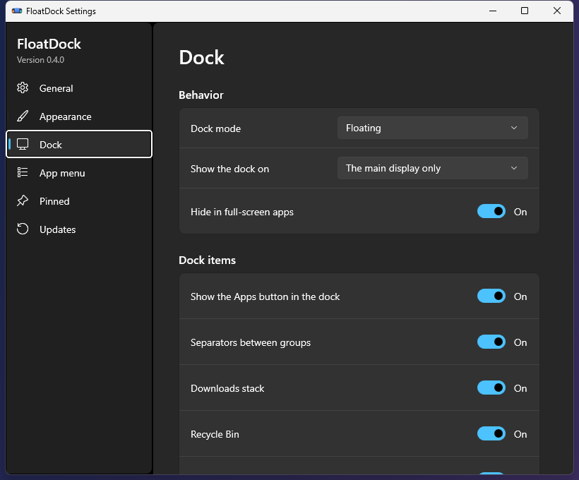

<div align="center">



# FloatDock

A floating dock for Windows 10 and 11, with pinned and running apps, a full-screen app menu and an optional replacement for the taskbar.

[](https://github.com/Simifar/floatdock/actions/workflows/build.yml)
[](LICENSE)
[](#requirements)
[](#build-from-source)
[](#status-and-limitations)

English · [Русский](README.ru.md)

<br>



</div>

<br>

FloatDock keeps Explorer as the Windows shell and puts a dock on top of it. The shelf shows the apps you pinned and the windows that are open, magnifies icons under the pointer and gets out of the way when you ask it to. On first run it offers to hide the Windows taskbar. The taskbar stays where it is until you agree.

It is written in C# on .NET 10 and WinUI 3, runs as the current user and needs no administrator rights.

## Features

- Running windows are grouped by app, with one indicator segment per window (up to three) and an orange one when an app asks for attention. Click to activate or minimize, hover for live window previews with a close button, or use the context menu to open a new window or close all of them.
- Pin apps, shortcuts, folders and files. Drop them on the dock from Explorer, drag a running app into place, drag a pinned icon off the dock to unpin it, or import the pins of the Windows taskbar. Folders open as a grid of recent items.
- Optional shelf items: Downloads, Recycle Bin, Show desktop, clock and date, and buttons for Quick settings and Notifications.
- An app menu that covers the screen and lists every installed app, packaged ones included. Type to search (it also understands text typed in the wrong keyboard layout, Russian and English), and see your most used apps first. You can sort the list, hide apps from it and spot new ones by a mark. Drag an app onto the dock to pin it. The default shortcut is Ctrl+Alt+A.
- Three placements: floating, reserved (maximized windows stop above the dock) and auto-hide. A dock on every display is available.
- Magnification that pushes the neighbours aside, icons that grow into the dock when an app starts and shrink away when it closes, and a pulse on the icon while an app starts. Motion follows the Reduce motion setting and the Windows animation setting.
- Settings you can see change live: icon size, magnification, spacing, shelf opacity and corner radius, light, dark or system theme, English or Russian.
- The dock hides in full-screen apps and comes back when they end.
- Optional taskbar replacement with a separate recovery process (see [below](#replacing-the-taskbar)).

## Screenshots

<table>
  <tr>
    <td align="center"><br><sub>Light theme</sub></td>
    <td align="center"><br><sub>App menu (on a machine with Russian Windows, so app names are Russian)</sub></td>
  </tr>
  <tr>
    <td align="center"><br><sub>Settings: Appearance</sub></td>
    <td align="center"><br><sub>Settings: Dock</sub></td>
  </tr>
</table>

## Install

1. Download [FloatDock-Setup.exe](https://github.com/Simifar/floatdock/releases/latest/download/FloatDock-Setup.exe) from the [latest release](https://github.com/Simifar/floatdock/releases/latest) and run it. It installs for the current user in `%LocalAppData%\FloatDockApp` and starts the dock. A portable zip, `FloatDockApp-win-Portable.zip`, is on the same page.
2. The files are not code-signed yet, so Windows SmartScreen may show "Windows protected your PC". Choose More info, then Run anyway. Each release lists the SHA-256 of its files.
3. To update, press Check for updates in Settings. The dock contacts nothing until you do, unless you turn on the check at startup (off by default). See [PRIVACY.md](PRIVACY.md).
4. To remove it, uninstall FloatDock in Windows Settings under Apps. The taskbar comes back first if FloatDock had hidden it. Your settings stay in `%LocalAppData%\FloatDock` until you delete that folder.

A winget package (`winget install Simifar.FloatDock`) and a Microsoft Store edition are prepared but not published yet. [docs/DISTRIBUTION.md](docs/DISTRIBUTION.md) describes both.

### Requirements

- Windows 11 x64, or Windows 10 version 1809 (build 17763) or later, x64. ARM64 is not built.
- No .NET runtime is needed: the release carries its own.
- FloatDock was developed and tested on Windows 11. On Windows 10 a build runner checks that it starts, and nothing more has been verified. Please report problems.

## Using FloatDock

| To do this | Do this |
| --- | --- |
| Open the app menu | Click the first button on the dock, or press Ctrl+Alt+A |
| Search the app menu | Start typing; Enter starts the best match, Esc clears the query, a second Esc closes the menu |
| Pin or unpin an app | Context menu on its icon, or drag it onto or off the dock |
| Start a new instance | Shift-click or middle-click the icon |
| Open Settings or exit | Right-click the shelf |
| Pick another shortcut for the app menu | Settings, App menu |

Command-line options of `FloatDock.App.exe`: `--settings` opens Settings, `--safe-mode` starts a plain floating dock without magnification, `--reset-settings` loads defaults, `--disable-taskbar-replacement` skips taskbar changes for this run, and `--restore-taskbar` asks a running dock to exit and undoes any leftover taskbar change. Settings live in `%LocalAppData%\FloatDock\settings.json`.

## Replacing the taskbar

This is optional and off by default. When you turn it on, FloatDock hides every Explorer taskbar and frees the work area (`ABS_AUTOHIDE`). It hides them again at once if Explorer shows one or restarts, and it undoes exactly that change on exit, on logoff and after a crash. The original state is written to a journal before anything changes, and a separate process called Guardian restores it if the dock dies. If something still goes wrong, run `FloatDock.App.exe --restore-taskbar` or use the Start menu entry Restore the Windows taskbar.

With the taskbar hidden, Windows keeps answering the Win key, Win+S, Win+Tab and Win+A (checked on Windows 11). The dock replaces the clock and adds buttons that open Quick settings and Notifications.

What is missing: notification-area icons of other apps are not shown, and neither are taskbar badges or progress. Windows has no public API for them. Explorer owns its taskbar and offers no supported way to replace it, so this feature relies on an unsupported window class. The Store edition leaves it out for that reason.

## Build from source

You need the .NET 10 SDK on Windows. The Windows App SDK comes from NuGet during the build.

```powershell
dotnet build FloatDock.slnx
dotnet test tests/FloatDock.Core.Tests/FloatDock.Core.Tests.csproj
dotnet run --project src/FloatDock.App/FloatDock.App.csproj
```

Release builds:

```powershell
scripts/build-release.ps1      # artifacts/FloatDock-win-x64 and a zip
scripts/build-velopack.ps1     # the installer and the update packages
scripts/build-msix.ps1         # the Microsoft Store package
```

`build-release.ps1` needs the C++ build tools (the "Desktop development with C++" workload of Visual Studio Build Tools), because Guardian is compiled ahead of time. Pass `-DotnetPath` if the SDK is not on `PATH`. With a code-signing certificate in your user store, pass `-CertificateThumbprint` to sign the binaries and the installer. See [CONTRIBUTING.md](CONTRIBUTING.md) for the release process.

## How it works

`src/FloatDock.Core` holds models, settings and layout maths, with no WinUI or Win32 in it. `src/FloatDock.Windows` wraps Win32 and shell calls. `src/FloatDock.App` is the WinUI interface. `src/FloatDock.Guardian` is the recovery helper. Window tracking uses out-of-context WinEvent hooks and an occasional full scan to repair lost events. [docs/ARCHITECTURE.md](docs/ARCHITECTURE.md) has the details and [docs/NATIVE-APIS.md](docs/NATIVE-APIS.md) lists every native API in use.

## Privacy and safety

FloatDock does not ask for administrator rights, inject code into other processes or read their memory. Pins store a typed launch target and never a shell command line. The only network use is the optional update check, which asks the address you entered in Settings for new versions and verifies the downloaded files against the SHA-256 in the feed. A crash writes a local minidump without heap to `%LocalAppData%\FloatDock\crashes` and sends nothing. See [PRIVACY.md](PRIVACY.md) and [SECURITY.md](SECURITY.md).

## Status and limitations

FloatDock is an early build. It works day to day on the machine it was written on, and these things are known:

- Pointer features (hover previews, magnification, drag and drop) were checked by hand only, because synthetic mouse input does not reach WinUI.
- A dock on every display was tested only with a simulated second display. A real second monitor, plugging and unplugging, a scale change while running, sleep and exclusive full-screen games are not verified.
- Accessibility (Narrator, high contrast) and 150 % and 200 % scale are not verified.
- No blur behind the shelf: blurring the whole window would also blur the transparent area above the shelf.
- No tray icons, badges or progress of other apps (see above).
- The binaries are not signed.
- An 8-hour soak run has not been done. [docs/TESTING.md](docs/TESTING.md) records what was checked and what was not.

## Contributing

Issues and pull requests are welcome. Read [CONTRIBUTING.md](CONTRIBUTING.md) first; it covers the build, the tests and the rules the code follows. Please report security problems privately, as [SECURITY.md](SECURITY.md) describes.

## License

[MIT](LICENSE). Third-party components are listed in [THIRD-PARTY-NOTICES.md](THIRD-PARTY-NOTICES.md).
