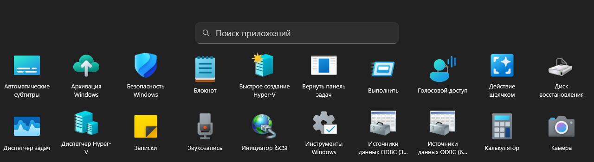
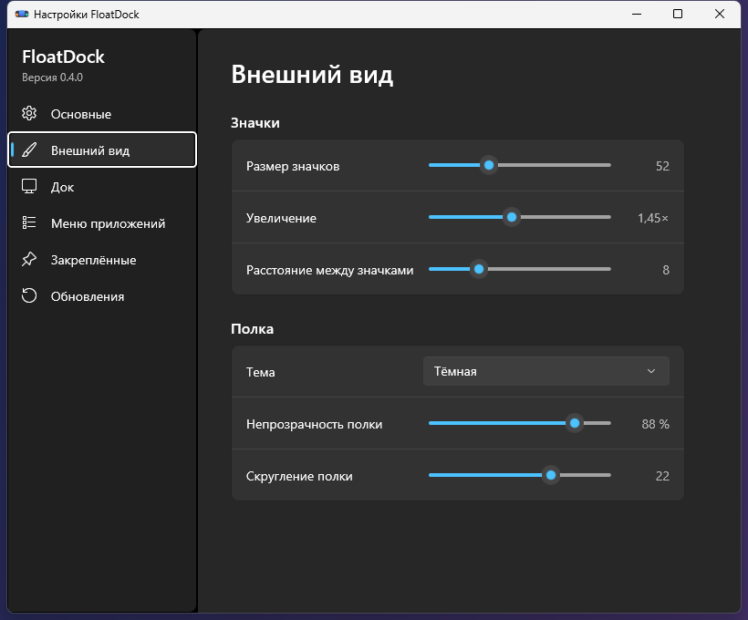
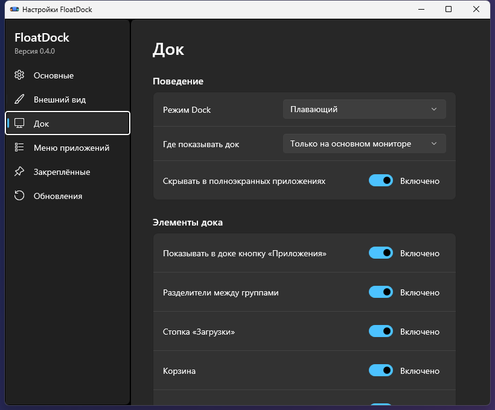

<div align="center">


# FloatDock

Плавающий док для Windows 10 и 11: закреплённые и запущенные приложения, меню всех приложений на весь экран и необязательная замена панели задач.

[](https://github.com/Simifar/floatdock/actions/workflows/build.yml)
[](LICENSE)
[](#требования)
[](#сборка-из-исходников)
[](#состояние-и-ограничения)

[English](README.md) · Русский

<br>


</div>

<br>

FloatDock оставляет Проводник оболочкой Windows и добавляет поверх него док. Полка показывает закреплённые приложения и открытые окна, увеличивает значки под указателем и прячется, когда вы так решили. При первом запуске он предлагает скрыть панель задач Windows. Пока вы не согласились, панель остаётся на месте.

Написан на C# с .NET 10 и WinUI 3, работает от имени текущего пользователя и не требует прав администратора.

## Возможности

- Окна группируются по приложению. У каждого окна свой сегмент индикатора (до трёх), оранжевый сегмент значит, что приложение просит внимания. Клик активирует или сворачивает окно, при наведении появляются живые превью окон с кнопкой закрытия, в контекстном меню есть «Новое окно» и «Закрыть все окна».
- Можно закреплять приложения, ярлыки, папки и файлы. Их можно перетащить на док из Проводника, перетащить запущенное приложение на нужное место, убрать закреплённый значок, утащив его с дока, или перенести закрепления панели задач Windows. Папка открывается сеткой последних элементов.
- Необязательные элементы полки: Загрузки, Корзина, «Показать рабочий стол», часы с датой, кнопки быстрых настроек и уведомлений.
- Меню приложений на весь экран со всеми установленными программами, в том числе из Microsoft Store. Поиск понимает текст в неверной раскладке (русская и английская), сверху лежат самые частые приложения. Список можно сортировать, приложения можно скрывать, новые помечаются. Приложение можно перетащить на док, чтобы закрепить. Сочетание по умолчанию: Ctrl+Alt+A.
- Три режима: плавающий, с резервом места (развёрнутые окна останавливаются над доком) и автоскрытие. Док можно показать на каждом мониторе.
- Увеличение раздвигает соседние значки. Значок запускаемого приложения въезжает в док, а при закрытии сжимается. Пока приложение стартует, значок мягко пульсирует. Анимации следуют настройке «Уменьшить анимацию» и настройке анимаций Windows.
- Параметры, которые видно сразу: размер значков, увеличение, расстояние между значками, непрозрачность и скругление полки, светлая, тёмная или системная тема, английский или русский язык.
- В полноэкранных приложениях док прячется и возвращается, когда они закрываются.
- Необязательная замена панели задач с отдельным процессом восстановления (см. [ниже](#замена-панели-задач)).

## Скриншоты

<table>
  <tr>
    <td align="center"><br><sub>Светлая тема</sub></td>
    <td align="center"><br><sub>Меню приложений</sub></td>
  </tr>
  <tr>
    <td align="center"><br><sub>Настройки: внешний вид</sub></td>
    <td align="center"><br><sub>Настройки: док</sub></td>
  </tr>
</table>

## Установка

1. Скачайте [FloatDock-Setup.exe](https://github.com/Simifar/floatdock/releases/latest/download/FloatDock-Setup.exe) из [последнего релиза](https://github.com/Simifar/floatdock/releases/latest) и запустите. Установка идёт для текущего пользователя в `%LocalAppData%\FloatDockApp`, после неё запускается док. Переносная версия, `FloatDockApp-win-Portable.zip`, лежит на той же странице.
2. Файлы пока не подписаны, поэтому SmartScreen может показать «Windows защитила ваш компьютер». Нажмите «Подробнее», затем «Выполнить в любом случае». В каждом релизе указаны SHA-256 всех файлов.
3. Для обновления нажмите «Проверить обновления» в настройках. Пока вы этого не сделали, док ничего не запрашивает по сети, если не включена проверка при запуске (по умолчанию выключена). Подробности в [PRIVACY.md](PRIVACY.md).
4. Чтобы удалить, найдите FloatDock в «Параметры Windows», «Приложения». Если док скрывал панель задач, она вернётся первой. Настройки остаются в `%LocalAppData%\FloatDock`, пока вы не удалите эту папку.

Пакет winget (`winget install Simifar.FloatDock`) и версия для Microsoft Store подготовлены, но ещё не опубликованы. Оба описаны в [docs/DISTRIBUTION.md](docs/DISTRIBUTION.md).

### Требования

- Windows 11 x64 или Windows 10 версии 1809 (сборка 17763) и новее, x64. Сборки для ARM64 нет.
- Среда .NET не нужна, она входит в релиз.
- Док разрабатывался и проверялся на Windows 11. На Windows 10 сборочный раннер проверяет только запуск, остальное не проверено. Если что-то не работает, напишите об этом.

## Как пользоваться

| Что сделать | Как |
| --- | --- |
| Открыть меню приложений | Нажать первую кнопку дока или Ctrl+Alt+A |
| Искать в меню | Начать печатать. Enter запускает лучшее совпадение, Esc очищает запрос, второй Esc закрывает меню |
| Закрепить или открепить приложение | Контекстное меню значка или перетаскивание на док и с дока |
| Запустить ещё один экземпляр | Shift+клик или клик средней кнопкой по значку |
| Открыть настройки или выйти | Правый клик по полке |
| Сменить сочетание для меню | Настройки, «Меню приложений» |

Параметры командной строки `FloatDock.App.exe`: `--settings` открывает настройки, `--safe-mode` запускает простой плавающий док без увеличения, `--reset-settings` загружает значения по умолчанию, `--disable-taskbar-replacement` пропускает изменения панели задач на этот запуск, `--restore-taskbar` просит работающий док выйти и отменяет оставшиеся изменения панели задач. Настройки лежат в `%LocalAppData%\FloatDock\settings.json`.

## Замена панели задач

Это необязательно и по умолчанию выключено. Когда вы включаете замену, FloatDock скрывает все панели задач Проводника и освобождает рабочую область (`ABS_AUTOHIDE`). Если Проводник показывает панель снова или перезапускается, док скрывает её сразу. При выходе, при выходе из сеанса и после сбоя он отменяет именно это изменение. Исходное состояние записывается в журнал до любых изменений, а отдельный процесс Guardian возвращает его, если док упал. Если что-то всё же пошло не так, запустите `FloatDock.App.exe --restore-taskbar` или пункт меню «Пуск» «Вернуть панель задач».

Пока панель скрыта, Windows продолжает отвечать на клавишу Win, Win+S, Win+Tab и Win+A (проверено на Windows 11). Док заменяет часы и добавляет кнопки быстрых настроек и уведомлений.

Чего нет: значки области уведомлений других приложений не показываются, значки на кнопках и индикаторы прогресса тоже. Публичного API для них в Windows нет. Проводник владеет своей панелью и не даёт поддерживаемого способа её заменить, поэтому функция опирается на неподдерживаемый класс окна. В версии для Store её нет по той же причине.

## Сборка из исходников

Нужен .NET 10 SDK на Windows. Windows App SDK подтягивается из NuGet при сборке.

```powershell
dotnet build FloatDock.slnx
dotnet test tests/FloatDock.Core.Tests/FloatDock.Core.Tests.csproj
dotnet run --project src/FloatDock.App/FloatDock.App.csproj
```

Сборка релиза:

```powershell
scripts/build-release.ps1      # artifacts/FloatDock-win-x64 и zip
scripts/build-velopack.ps1     # установщик и пакеты обновления
scripts/build-msix.ps1         # пакет для Microsoft Store
```

Для `build-release.ps1` нужны C++ Build Tools (набор «Разработка классических приложений на C++» в Visual Studio Build Tools): Guardian компилируется заранее (AOT). Если SDK не в `PATH`, передайте `-DotnetPath`. Если сертификат подписи кода лежит в вашем хранилище, `-CertificateThumbprint` подпишет файлы и установщик. Порядок выпуска описан в [CONTRIBUTING.md](CONTRIBUTING.md).

## Устройство

В `src/FloatDock.Core` лежат модели, настройки и математика раскладки, без WinUI и Win32. `src/FloatDock.Windows` оборачивает вызовы Win32 и оболочки. `src/FloatDock.App` это интерфейс на WinUI. `src/FloatDock.Guardian` процесс восстановления. Окна отслеживаются через внешние хуки WinEvent и редкий полный обход, который чинит потерянные события. Подробности в [docs/ARCHITECTURE.md](docs/ARCHITECTURE.md), список всех используемых системных API в [docs/NATIVE-APIS.md](docs/NATIVE-APIS.md). Эти документы на английском.

## Приватность и безопасность

FloatDock не просит прав администратора, не внедряет код в другие процессы и не читает их память. В закреплениях хранится типизированная цель запуска, а не командная строка. Сеть используется только для необязательной проверки обновлений: она обращается к адресу, который вы указали в настройках, и сверяет скачанные файлы с SHA-256 из ленты. При сбое на диск пишется локальный минидамп без кучи в `%LocalAppData%\FloatDock\crashes`, наружу ничего не отправляется. См. [PRIVACY.md](PRIVACY.md) и [SECURITY.md](SECURITY.md).

## Состояние и ограничения

FloatDock это ранняя сборка. На машине, где он написан, он работает каждый день. Известно следующее:

- Функции с указателем (превью при наведении, увеличение, перетаскивание) проверены только вручную: синтетический ввод мыши до WinUI не доходит.
- Док на каждом мониторе проверен только на имитации второго монитора. Настоящий второй монитор, подключение и отключение, смена масштаба во время работы, сон и игры в эксклюзивном полноэкранном режиме не проверены.
- Доступность (Narrator, высокая контрастность) и масштаб 150 % и 200 % не проверены.
- Размытия за полкой нет: размытие всего окна размыло бы и прозрачную область над полкой.
- Нет значков трея, значков на кнопках и прогресса других приложений (см. выше).
- Файлы не подписаны.
- Восьмичасовой прогон не делался. В [docs/TESTING.md](docs/TESTING.md) записано, что проверено и что нет.

## Участие

Обращения и pull request приветствуются. Сначала прочтите [CONTRIBUTING.md](CONTRIBUTING.md): там сборка, тесты и правила для кода. О проблемах безопасности сообщайте приватно, как описано в [SECURITY.md](SECURITY.md).

## Лицензия

[MIT](LICENSE). Сторонние компоненты перечислены в [THIRD-PARTY-NOTICES.md](THIRD-PARTY-NOTICES.md).
